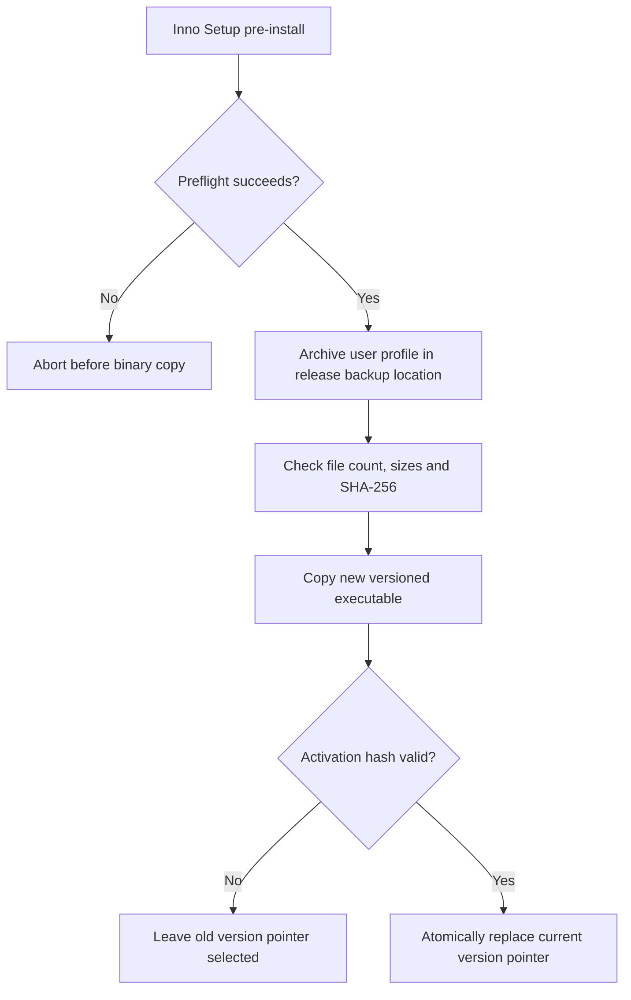

# Pilot: versioned installation and user-data snapshot | Overview

## Inventory

| Component | Current role | Read/write boundary |
| --- | --- | --- |
| `scripts/madar-update.iss` | Inno Setup customer installer; calls preflight before copying; runs activation after installation | Versioned binary, launcher, shortcuts; `DataRoot()` resolves to `{userappdata}\MadarDesk` |
| `scripts/Madar-Upgrade-Preflight.ps1` | Checks input paths, prohibits reparse points and running Madar processes/service, snapshots and checks every file | Reads profile tree; writes verified ZIP under backup root; does **not** change profile |
| `scripts/Madar-Activate-Version.ps1` | Verifies target EXE SHA-256 and changes version pointer | Writes `current-version.txt`, maintains `previous-version.txt` |
| `scripts/build_inno_update.py` | Compiles fixed 1.0.2 release using Inno Setup and verifies WebView2 prerequisite signature | Build artifacts under `release/`; no user profile writes |
| `tests/test_madar_update_contract.py` | Four original tests plus five root/locked-source/bulk/repeated-backup/activation tests in phase 2 | Temporary directories, fake binaries and unmounted-drive path inputs only |

Code references: `scripts/madar-update.iss:64-70,125-173`; `scripts/Madar-Upgrade-Preflight.ps1:11-97`; `scripts/Madar-Activate-Version.ps1:10-44`; `tests/test_madar_update_contract.py:30-121`.

## Current data flow

## Invariants and known caveats

- The profile is under `%APPDATA%\MadarDesk`, while versioned executables are under `%LOCALAPPDATA%\Programs\MadarDesk\versions`. ZIP archives live outside the profile.
- The preflight is expected to fail closed if Madar/MadarHost is running, source includes junctions/links, roots overlap, or a snapshot does not match its source.
- The actual full customer upgrade, rollback on schema incompatibility and all legacy Parsian data remain **outside this pilot**. Existing tests use disposable fixtures only.
- The original path resolver accepted a drive-volume root and removed its trailing separator, leaving a drive-relative path (for example `X:` rather than the intended absolute volume root). The safety risk is unintended drive-wide or relative-directory selection. The pilot rejects volume roots explicitly; this is an intentional security change rather than parity.
- Phase 2 now stages backups under `.Madar-InProgress-<GUID>.partial` and publishes a uniquely named final ZIP only after file counts, lengths and SHA-256 checks succeed. Failed snapshots remove their partial file. Dictionary-based entry matching rejects duplicates and avoids repeated linear archive scans.
- The activation script now rejects an unmounted drive root (or a path normalized to it) before resolving the executable; existing hash, version pointer, repair and rollback contracts remain.

## Findings versus inference

- Confirmed in code: pointer change uses `File.Replace` when the old pointer exists; matching file hashes are required to activate.
- Confirmed in baseline test run on 2026-11-01: `python -m unittest tests.test_madar_update_contract -v` ran four tests, all passing.
- Not verified here: full Windows 10/11 clean-device behavior, real financial migration, and interrupted-write rollback.
